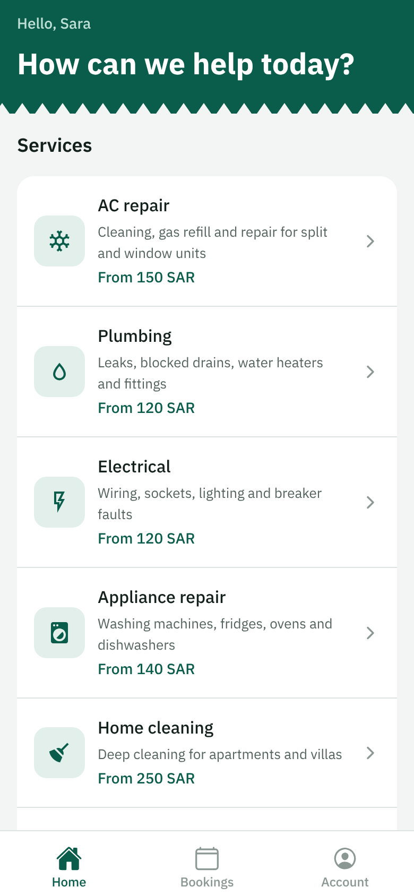
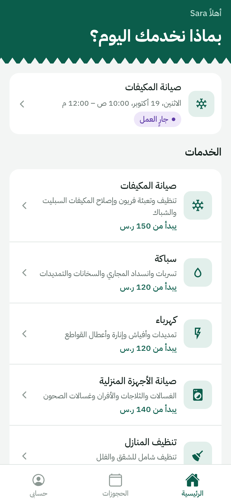
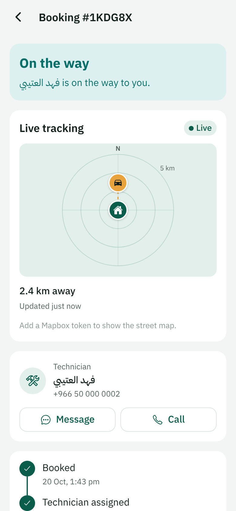
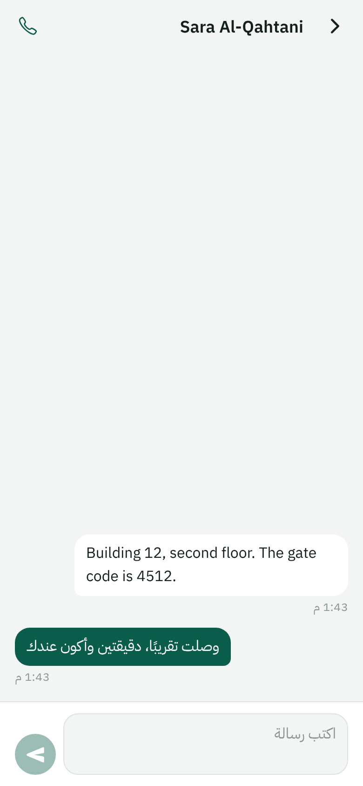
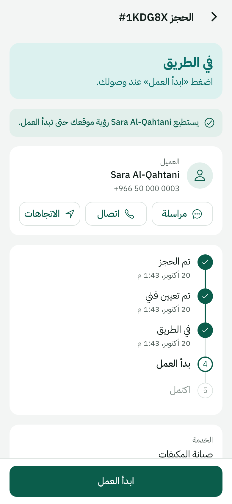
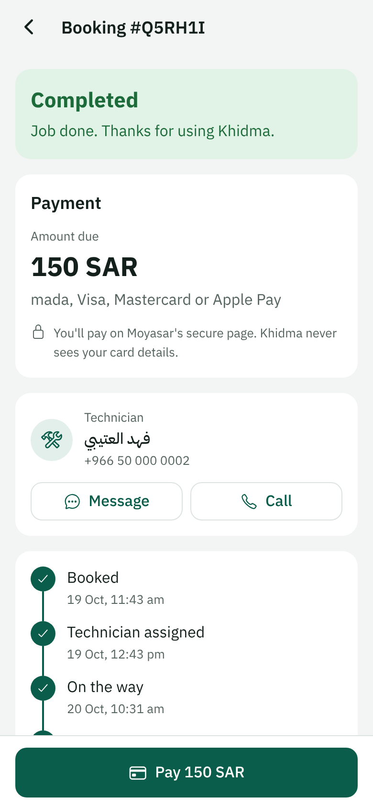
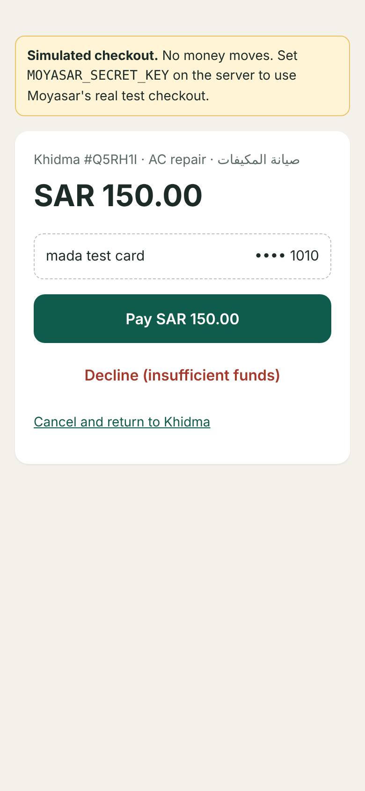
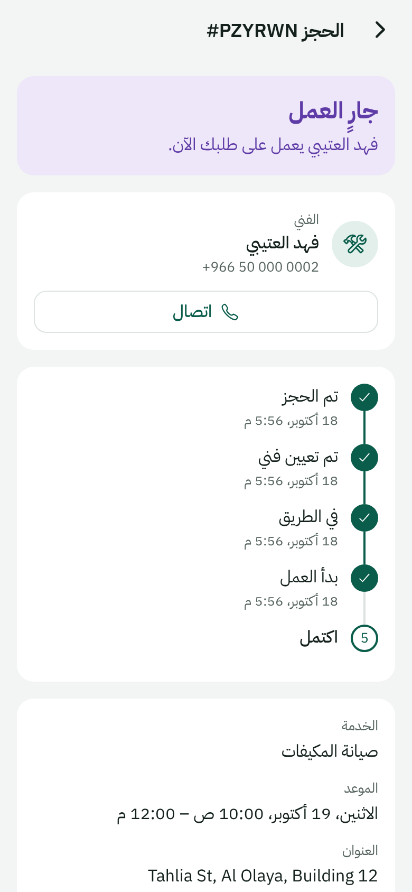
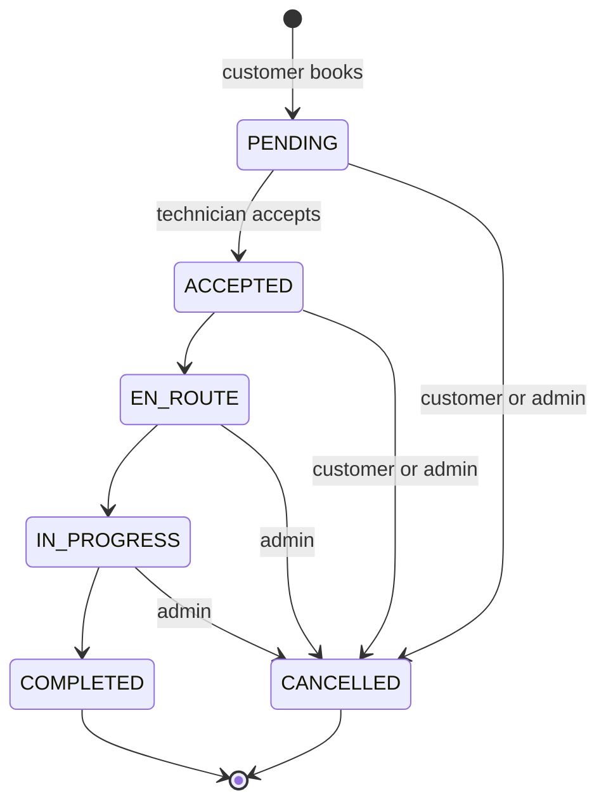

# Khidma · خدمة

On-demand home services for Saudi Arabia. Customers book AC repair, plumbing, cleaning and more in Arabic or English; technicians accept jobs, share live location on the way, and get paid through Mada and card payments.

| Part | Stack | Status |
| --- | --- | --- |
| `server/` REST API | Node.js, Express 5, TypeScript, Prisma 7, PostgreSQL | Done: auth, catalog, bookings, roles |
| `mobile/` customer + technician app | React Native, Expo SDK 58, Expo Router, TanStack Query, Zustand | Done: sign-in, booking, jobs, Arabic RTL ([details](mobile/README.md)) |
| Real-time tracking and chat | Socket.IO, Mapbox | Done: live technician location, in-app chat, instant status updates |
| Payments and push notifications | Moyasar (mada, Visa, Mastercard, Apple Pay), Expo push (FCM/APNs) | Done: hosted checkout, webhook, localized notifications |
| `admin/` dashboard | Next.js | Planned |

<p>
  
  
  
  
</p>
<p>
  
  
  
  
</p>

## Quick start (API)

You need Node.js 20+ and Docker (or a local PostgreSQL 16).

```bash
docker compose up -d              # Postgres with `khidma` and `khidma_test` databases
cd server
cp .env.example .env              # then set JWT_SECRET and OTP_SECRET
npm install                       # also generates the Prisma client
npm run db:deploy                 # apply migrations
npm run db:seed                   # services + demo accounts
npm run dev                       # http://localhost:4000
```

There is no SMS gateway in development: one-time codes are printed in the server console.

Then run the app on your phone with Expo Go: see [mobile/README.md](mobile/README.md).

Demo accounts created by the seed (log in with the phone number, then read the code from the console):

| Role | Phone |
| --- | --- |
| Admin | 0500000001 |
| Technician (approved, offers every service) | 0500000002 |
| Customer (has a finished job waiting for payment) | 0500000003 |

Nothing else needs an account to try: without Moyasar keys the API serves a simulated checkout page, and without a Mapbox token the app shows a direction-and-distance diagram instead of the street map. See [Payments](#payments-moyasar) and [mobile/README.md](mobile/README.md) to switch on the real services.

### Try it with curl

```bash
curl -X POST localhost:4000/auth/otp/request -H 'content-type: application/json' -d '{"phone":"0500000003"}'
# copy the 6-digit code from the server console
curl -X POST localhost:4000/auth/otp/verify -H 'content-type: application/json' -d '{"phone":"0500000003","code":"123456"}'
curl localhost:4000/bookings -H "authorization: Bearer <token>"
```

## Tests

```bash
cd server && npm test     # API: 80 tests, Jest + Supertest + socket.io-client against a real Postgres
cd mobile && npm test     # app: 61 tests, Jest + React Native Testing Library
```

Server tests cover the real HTTP and Socket.IO stack: two sockets on a real port check that a location reaches the customer and nobody else, the webhook, the return page and the app hit the API at the same moment to prove a payment is counted once, and push notifications are captured in memory per device. SMS, push and payments use in-memory implementations of the same interfaces the app uses in production.

The test run rebuilds `khidma_test` from the migration files, so tests always use the same schema production gets. It refuses to run against a database whose name doesn't end in `_test`. GitHub Actions runs both on every push (`.github/workflows/ci.yml`): typecheck, migrations, tests and build for the API; typecheck, lint, tests and a full bundle for the app.

## API

All responses are JSON. Errors look like `{ "error": { "code": "BOOKING_UNAVAILABLE", "message": "..." } }`; the app translates by `code`.

| Method | Path | Who | What |
| --- | --- | --- | --- |
| POST | `/auth/otp/request` | anyone | Send a 6-digit code by SMS |
| POST | `/auth/otp/verify` | anyone | Exchange the code for a JWT (creates the account on first login) |
| GET / PATCH | `/me` | signed in | Profile, language, push token |
| GET | `/services` | anyone | Service catalog in Arabic and English |
| GET | `/service-areas` | anyone | Cities Khidma serves |
| POST | `/technicians/apply` | customer | Apply to become a technician |
| PATCH | `/technicians/me` | technician | Availability, bio, services offered |
| POST | `/bookings` | customer | Book a service |
| GET | `/bookings?scope=active\|past` | signed in | My bookings |
| GET | `/bookings/open` | approved technician, online | Jobs I can take (approximate location only) |
| GET | `/bookings/:id` | participant or admin | Booking details |
| POST | `/bookings/:id/accept` | approved technician, online | Claim a job |
| POST | `/bookings/:id/status` | assigned technician | `EN_ROUTE` → `IN_PROGRESS` → `COMPLETED` |
| POST | `/bookings/:id/cancel` | customer or admin | Cancel |
| GET | `/bookings/:id/messages?before=&limit=` | participant or admin | Chat history, newest page first |
| POST | `/bookings/:id/messages` | customer or assigned technician | Send a chat message (from acceptance until the job is done) |
| POST | `/bookings/:id/payment` | customer, job completed | Open a Moyasar checkout; returns `checkoutUrl` |
| POST | `/bookings/:id/payment/verify` | customer | Re-check the payment with Moyasar after checkout |
| POST | `/payments/moyasar/webhook` | Moyasar | Payment events (checked with the shared secret) |
| GET | `/payments/return/:paymentId` | browser | Where checkout sends the customer; redirects back into the app |
| GET | `/admin/technicians?status=pending` | admin | Technician applications |
| POST | `/admin/technicians/:userId/approve` | admin | Approve a technician |
| GET | `/admin/bookings?status=&page=` | admin | All bookings, paginated |

### Real-time events (Socket.IO, same port as the API)

Connect with `io(API_URL, { auth: { token } })` using the same JWT. The server puts each socket in a room for its user (plus `technicians` or `admins`) and decides who receives what from the database, so a client can't subscribe to someone else's booking.

| Direction | Event | Payload | Who |
| --- | --- | --- | --- |
| server → app | `booking:changed` | `{ bookingId, status }` | customer, assigned technician, admins |
| server → app | `jobs:changed` | none | technicians (a job was created, taken or cancelled) |
| server → app | `message:new` | `{ message }` | both people on the job |
| server → app | `location` | `{ bookingId, lat, lng, heading, at }` | the customer, while the technician is on the way |
| server → app | `profile:changed` | none | a technician who was just approved |
| app → server | `location:update` | `{ lat, lng, heading? }`, acknowledged | technicians with a job in `EN_ROUTE` |

Booking events carry only an id: the app refetches through the REST API, which applies the usual permission checks.

## Booking lifecycle



## Engineering notes

- **No double booking.** Accepting a job is a single conditional update (`WHERE status = 'PENDING' AND technicianId IS NULL`). When two technicians tap Accept at once, Postgres lets exactly one update win; the other gets `409`. There's a test that fires both requests in parallel.
- **Status changes can't skip steps.** Every transition is guarded the same way (`WHERE status = <required previous status>`), so a stale or replayed request fails instead of corrupting the job.
- **OTP security.** Codes are stored as HMAC-SHA256 hashes bound to the phone number, expire after 5 minutes, allow 5 guesses (counted atomically), and each number can request 3 codes per 10 minutes. Requesting a new code invalidates the old one. A per-IP rate limit sits in front of the auth routes.
- **Saudi phone numbers in any format.** `05…`, `5…`, `+966…`, `00966…`, with spaces or dashes, and in Arabic-Indic digits (`٠٥…`) from Arabic keyboards, all normalize to E.164.
- **Money in halalas.** Prices are integers (15000 = 150.00 SAR), and each booking keeps a snapshot of the price at the time it was made.
- **Service areas.** Bookings are accepted only inside launched cities (haversine distance from each city centre). The Dammam & Khobar radius stops short of Bahrain.
- **Privacy.** Technicians browsing open jobs see the area (coordinates rounded to about 1 km) but not the street address or the customer's name and phone until they accept. Bookings you're not part of return `404`, not `403`, so ids can't be probed.
- **Roles take effect immediately.** The auth middleware loads the user on every request instead of trusting the role inside the JWT, so approving a technician doesn't require them to log in again.
- **Swappable SMS.** `SmsProvider` is an interface: console in development, in-memory in tests, a real gateway (Unifonic, Twilio) in production.

## Real-time tracking and chat

- **Location is shared only on the way.** The technician's phone sends its position every few seconds while a job is `EN_ROUTE`, and the server forwards it to that job's customer only. Before they set off and after they start work, updates are refused (`NOT_EN_ROUTE`) and the booking stops including a location. A position saved before the trip started is never shown.
- **Rate-limited and validated.** Coordinates are checked with zod and each socket can send at most one update every 2 seconds. Chat is limited to 30 messages a minute per sender (counted in the database, so it holds across server instances).
- **Chat belongs to the job.** It opens when a technician accepts and becomes read-only when the job is completed or cancelled. Admins can read it (for disputes) but not post. Messages page backwards with a `(createdAt, id)` cursor.
- **Events, not coupling.** Bookings, chat and payments publish domain events on a small typed `EventBus`; the Socket.IO layer and push notifications subscribe. A failing subscriber is logged and never breaks the request. Tests call `events.settled()` to wait for side effects.

## Payments (Moyasar)

Customers pay after the job is done, on Moyasar's hosted checkout (mada, Visa, Mastercard, Apple Pay). Card details are entered on Moyasar's page, so they never touch the app or the API.

1. The app calls `POST /bookings/:id/payment` with its own return address. The API creates a Moyasar **invoice** for the booking's price snapshot and returns the checkout URL.
2. The app opens it in an in-app browser (a full-page redirect on the web).
3. Moyasar sends the browser to `/payments/return/:paymentId`; the API checks the invoice with Moyasar and redirects into the app with `?payment=paid|pending|failed`. The in-app browser closes itself.
4. The app calls `/payment/verify`, and Moyasar's **webhook** reports the payment too, in case the customer closed the browser early.

Security details:

- **Never trust the redirect or the webhook body.** Both only trigger a fresh read of the invoice from Moyasar's API with the secret key. The webhook must also carry the shared secret, compared in constant time.
- **The amount must match.** A paid invoice for a different amount or currency is marked failed and logged, never paid.
- **Exactly once.** Updates are conditional on the status we read (`UPDATE … WHERE status = <previous>`), so the return page, the app and the webhook can all arrive together and the technician still gets one "payment received" notification. A paid payment can only move to refunded.
- **No open redirect.** The return address must be the app's own scheme (`khidma://`), Expo Go (`exp://`, development only), or a web origin you allow in `CORS_ORIGINS`.
- **Reuse, don't duplicate.** Tapping Pay again within 50 minutes reuses the open invoice; after a declined card the same checkout stays usable. Invoices expire after an hour.

**Without keys** (development), `SimulatedGateway` stands in for Moyasar: the checkout is a page served by the API with Pay and Decline buttons, and the rest of the flow is identical. The API refuses to start in production without `MOYASAR_SECRET_KEY`.

**With Moyasar test keys:** in the Moyasar dashboard (test mode) copy the secret key into `MOYASAR_SECRET_KEY`. For webhooks, expose the API publicly (for example with a tunnel), set `PUBLIC_API_URL`, and add a webhook for `<PUBLIC_API_URL>/payments/moyasar/webhook` with the same secret token as `MOYASAR_WEBHOOK_SECRET`. Pay with Moyasar's test cards, for example mada `4201 3201 1111 1010` (paid) or Visa `4111 1111 1111 1111` (paid), any future expiry, any 3-digit CVC, and a two-word name.

## Push notifications

The API sends notifications through Expo's push service, which delivers through Firebase Cloud Messaging on Android and APNs on iOS. Each is written in the recipient's language and opens the right screen when tapped.

| When | Who | Example (English) |
| --- | --- | --- |
| New booking | online technicians who offer the service | New job: AC repair · Riyadh · Tue 21 Oct, 10:00 am |
| Accepted / on the way / started / completed | the customer | Fahd is on the way |
| Cancelled | whoever didn't cancel | Booking cancelled |
| Chat message | the other person | Sara: Building 12, second floor |
| Paid | the technician | Payment received · 150 SAR |
| Application approved | the new technician | You're approved |

- Tokens from uninstalled apps (`DeviceNotRegistered`) are deleted. A device's token moves to whoever signed in on it last, so a shared phone never shows the previous account's messages. Signing out clears it.
- Notifications for the same booking are sent in order, so "Work has started" can't overtake "On the way".
- The app only follows links to its own booking, chat and jobs screens.
- `PUSH_ENABLED=false` prints notifications in the console instead.

Receiving notifications needs a development build of the app (Expo Go doesn't support remote push); see [mobile/README.md](mobile/README.md#development-build-map-and-push-notifications).

## Project structure

```
server/
  prisma/
    schema.prisma          data model
    migrations/            SQL migrations
    seed.ts                services and demo accounts
  src/
    app.ts                 Express app (routes, middleware)
    server.ts              entry point: HTTP + Socket.IO on one port
    config.ts              environment validation (zod)
    lib/                   errors, phone numbers, JWT, service areas
    middleware/            auth + roles, error handler
    modules/
      auth/                OTP login, SMS providers
      bookings/            booking service, state machine, routes
      chat/                per-booking messages
      payments/            Moyasar gateway, simulated checkout, webhook, return page
      notifications/       Expo push provider, localized templates, event → notification
      technicians/         apply, availability
      admin/               approvals, booking list
    realtime/socket.ts     Socket.IO: auth, rooms, location sharing, event fan-out
    lib/events.ts          typed domain event bus
  tests/                   Jest + Supertest + socket.io-client
```
